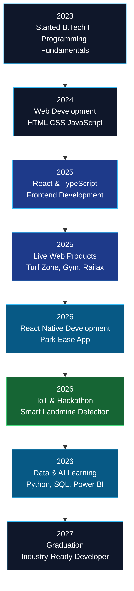
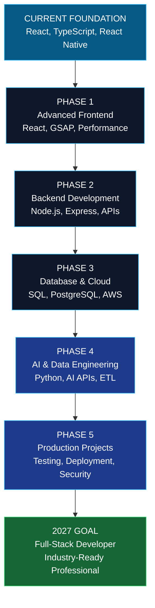
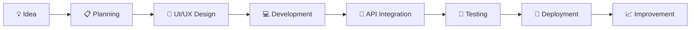
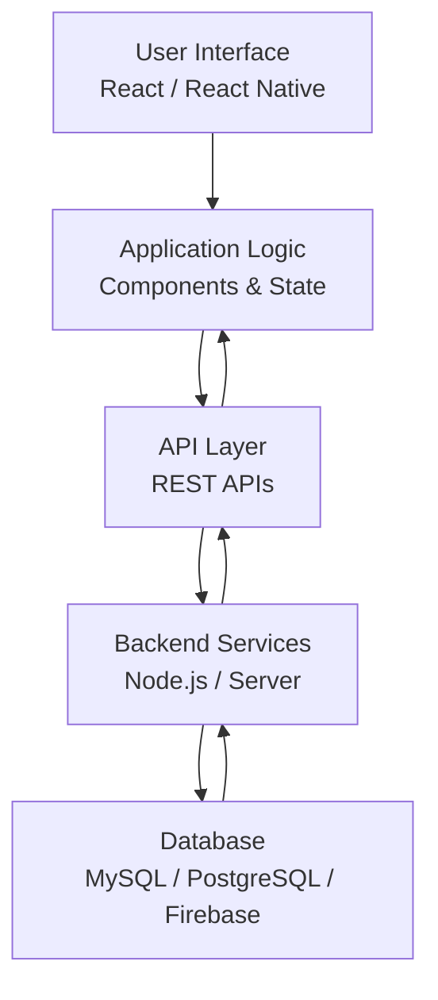

<!-- ===================================================== -->
<!--                 DHANASEELAN A - GITHUB                 -->
<!--                  DEVELOPER PORTFOLIO V3                 -->
<!-- ===================================================== -->

<!-- HERO -->


<p align="center">
  
</p>

<p align="center">
  <a href="https://portfolio-dun-mu-68.vercel.app/"></a>
  <a href="https://github.com/adhanaseelan"></a>
  <a href="https://www.linkedin.com/in/dhanaseelan-mass/"></a>
  <a href="mailto:dhanaseelandhanaseelan464@gmail.com"></a>
</p>

<p align="center">
  
</p>

---

<!-- NAVIGATION -->

<p align="center">
  <a href="#-about-me">About</a> •
  <a href="#-developer-journey">Journey</a> •
  <a href="#-project-showcase">Projects</a> •
  <a href="#-live-project-previews">Live Previews</a> •
  <a href="#-demo-videos">Videos</a> •
  <a href="#-career-roadmap">Roadmap</a> •
  <a href="#-technology-stack">Skills</a> •
  <a href="#-experience">Experience</a> •
  <a href="#-achievements">Achievements</a> •
  <a href="#-github-analytics">Analytics</a> •
  <a href="#-contact">Contact</a>
</p>

---

<!-- ABOUT -->

## 👨‍💻 About Me


Hi! I'm **Dhanaseelan A**, a Full-Stack and React Native Developer passionate about building real-world web and mobile applications.

I enjoy transforming ideas into working products with modern technologies, clean UI/UX, reusable components and scalable application architecture.

Currently pursuing B.Tech Information Technology at Nandha Engineering College, Erode.

```javascript
const dhanaseelan = {
    name: "Dhanaseelan A",
    role: "Full-Stack Developer",

    education: "B.Tech Information Technology",
    college: "Nandha Engineering College",
    graduation: 2027,
    cgpa: "8.5/10",

    location: "Tamil Nadu, India",

    expertise: [
        "React.js",
        "React Native",
        "TypeScript",
        "JavaScript",
        "Python",
        "SQL",
        "Power BI"
    ],

    achievements: [
        "4 Live Products",
        "1 Play Store Application",
        "First Prize - 24 Hour Hackathon"
    ],

    interests: [
        "Full-Stack Development",
        "Mobile Development",
        "UI/UX Design",
        "Artificial Intelligence",
        "Data Engineering"
    ],

    currentlyLearning: [
        "Advanced React",
        "GSAP",
        "AWS",
        "AI Integration"
    ],

    goal: "Build scalable real-world software"
};
```

### Quick Highlights

<p align="center">
  
  
  
  
</p>

---

<!-- DEVELOPER JOURNEY -->

## 🛣️ My Developer Journey

Every project teaches something new. Here is my journey from learning programming to building real-world applications.



### My Journey in Stages

| Stage | Focus | Milestone |
|---|---|---|
| 2023 | Programming fundamentals | Started B.Tech IT |
| 2024 | Web development | Built frontend foundations |
| 2025 | React & TypeScript | Developed live web platforms |
| 2026 | Mobile & IoT | Published Park Ease and won hackathon prize |
| 2026–27 | Full Stack, AI & Data | Expanding technical expertise |
| 2027 | Career launch | Expected graduation |

---

<!-- PROJECT SHOWCASE -->

## 🚀 Project Showcase

Here are some applications and technical projects I have worked on.

### 01. 🏟️ Turf Zone

**Sports Ground Booking & Management Platform**

<p align="center">
  
</p>

**Overview**

A sports ground booking platform designed to simplify slot reservations and management.

**Features**
- OTP-based authentication.
- Ground slot availability.
- Booking management.
- Payment tracking.
- Revenue reports.

**Tech Stack:** React.js · TypeScript · REST APIs

🔗 [Live Website](https://turrfzone.com/)

---

### 02. 🏋️ Gym Management System

**Gym Membership & Administration Platform**

<p align="center">
  
</p>

**Overview**

A management platform for handling gym members, memberships, attendance and payments.

**Features**
- Member registration.
- Membership management.
- Attendance tracking.
- Payment management.
- Revenue dashboard.
- Expiry alerts.

**Tech Stack:** React.js · TypeScript

🔗 [Live Website](https://gym.artechnology.pro/)

---

### 03. 🚆 Railax

**Railway Waiting Hall Booking Platform**

<p align="center">
  
</p>

**Overview**

A railway waiting hall booking platform for Erode and Tiruppur with administrative management features.

**Features**
- Waiting hall booking.
- Admin dashboard.
- Biller dashboard.
- Role-based access.
- Booking management.

**Tech Stack:** React.js · TypeScript · Tailwind CSS

🔗 [Live Website](https://railax.artechnologi.com/)

---

### 04. 🅿️ Park Ease

**Smart Parking Mobile Application**

<p align="center">
  
</p>

**Overview**

A React Native mobile application for managing parking entry, exit and automatic parking charges.

**Features**
- Card scanning.
- Vehicle entry and exit.
- Parking duration calculation.
- Automatic parking fee calculation.
- Mobile application interface.

**Tech Stack:** React Native · TypeScript · JavaScript · NativeWind

🔗 [Google Play Store](https://play.google.com/store/apps/details?id=com.parkease24.app)

---

### 05. 🛰️ Smart Landmine Detection & Soldier Monitoring

<p align="center">
  
</p>

**Overview**

An IoT-based prototype designed to detect metallic landmines with vibration alerts and GPS tracking.

**Features**
- ESP32 integration.
- Metal detection sensor.
- Vibration alert.
- GPS location tracking.
- Firebase integration.

**Tech Stack:** ESP32 · Embedded C · NEO-6M GPS · Firebase

🏆 **First Prize – 24-Hour Hackathon**

---

### 06. 🗓️ Time Table Scheduler

<p align="center">
  
</p>

**Overview**

An academic scheduling application that generates conflict-free timetables using faculty, subject and classroom information.

**Features**
- Faculty management.
- Subject allocation.
- Classroom management.
- Scheduling conflict prevention.

**Tech Stack:** Web Development · Database Management

---

<!-- LIVE PROJECT PREVIEWS -->

## 🌐 Live Project Previews

Explore my deployed applications directly.

<table>
<tr>
<td align="center" width="50%">
  <a href="https://turrfzone.com/">
    
  </a>
  <br/>
  <b>Turf Zone</b>
  <br/>
  <a href="https://turrfzone.com/">Visit Application ↗</a>
</td>
<td align="center" width="50%">
  <a href="https://gym.artechnology.pro/">
    
  </a>
  <br/>
  <b>Gym Management</b>
  <br/>
  <a href="https://gym.artechnology.pro/">Visit Application ↗</a>
</td>
</tr>
<tr>
<td align="center" width="50%">
  <a href="https://railax.artechnologi.com/">
    
  </a>
  <br/>
  <b>Railax</b>
  <br/>
  <a href="https://railax.artechnologi.com/">Visit Application ↗</a>
</td>
<td align="center" width="50%">
  <a href="https://play.google.com/store/apps/details?id=com.parkease24.app">
    
  </a>
  <br/>
  <b>Park Ease</b>
  <br/>
  <a href="https://play.google.com/store/apps/details?id=com.parkease24.app">View on Play Store ↗</a>
</td>
</tr>
</table>

---

<!-- VIDEO DEMOS -->

## 🎬 Project Demo Videos

I also showcase project functionality through application walkthroughs and development demonstrations.

### Turf Zone – Website Demo

<p align="center">
  <a href="https://www.youtube.com/watch?v=YOUR_TURFZONE_VIDEO_ID">
    
  </a>
</p>

<p align="center">
  <b>▶ Watch Turf Zone Application Demo</b>
</p>

### Park Ease – Mobile Application Demo

<p align="center">
  <a href="https://www.youtube.com/watch?v=YOUR_PARKEASE_VIDEO_ID">
    
  </a>
</p>

<p align="center">
  <b>▶ Watch Park Ease Mobile Demo</b>
</p>

### Smart Landmine Detection – Project Demo

<p align="center">
  <a href="https://www.youtube.com/watch?v=YOUR_LANDMINE_VIDEO_ID">
    
  </a>
</p>

<p align="center">
  <b>▶ Watch Hardware Project Demo</b>
</p>

---

<!-- CAREER ROADMAP -->

## 🎯 My Career Roadmap – 2026 to 2027

My goal is to become a strong Full-Stack Developer with additional knowledge of AI integration and Data Engineering.



### My Learning Goals

- [ ] Master advanced React and TypeScript.
- [ ] Improve GSAP animations and UI interactions.
- [ ] Strengthen Node.js and Express.js.
- [ ] Build scalable REST APIs.
- [ ] Improve PostgreSQL and database design.
- [ ] Learn AWS fundamentals and deployment.
- [ ] Build AI-powered applications.
- [ ] Improve Python and Data Engineering skills.
- [ ] Build and deploy more production-ready projects.
- [ ] Prepare for Full-Stack Developer opportunities.

---

<!-- DEVELOPMENT WORKFLOW -->

## ⚙️ My Development Workflow

How I approach building an application:



### My Engineering Principles

| Principle | My Focus |
|---|---|
| Clean Code | Readable and reusable components |
| UI/UX | User-friendly interfaces |
| Performance | Efficient application rendering |
| Security | Secure authentication and data handling |
| Scalability | Maintainable application architecture |
| Teamwork | Collaboration and communication |

---

<!-- ARCHITECTURE -->

## 🏗️ Application Architecture

My typical full-stack application development approach:



---

<!-- SKILLS -->

## 🧰 Technology Stack

### Frontend Development

<p>

</p>

### Mobile Development

<p>

</p>

React Native · NativeWind · Mobile UI Development

### Backend & Database

<p>

</p>

### Programming Languages

<p>

</p>

### Data Analytics

- Python
- Pandas
- NumPy
- SQL
- Power BI
- Excel
- Data Cleaning
- Data Visualization

### Tools & Design

<p>

</p>

---

<!-- EXPERIENCE -->

## 💼 Experience

### AST Technologies – Frontend Developer Intern

**June 2025 – July 2025**

- Developed responsive interfaces using React.js.
- Built reusable components using TypeScript.
- Integrated REST APIs.
- Worked with Tailwind CSS.
- Contributed to Vehicle Management System development.

**Technologies:** React.js · TypeScript · Tailwind CSS · REST APIs

### AR Technologi – Mobile Application Developer Intern

**December 2025 – January 2026**

- Developed mobile application interfaces.
- Worked with React Native and NativeWind.
- Integrated APIs and dynamic data.
- Implemented application navigation.
- Used Git and GitHub for version control.
- Contributed to Park Ease application development.

**Technologies:** React Native · JavaScript · TypeScript · NativeWind

---

<!-- EDUCATION -->

## 🎓 Education

| Qualification | Institution | Duration | Score |
|---|---|---|---|
| B.Tech Information Technology | Nandha Engineering College | 2023–2027 | 8.5 CGPA |
| Higher Secondary | Diamond Jubilee Higher Secondary School | 2021–2023 | 80% |

---

<!-- ACHIEVEMENTS -->

## 🏆 Achievements & Leadership

- 🥇 First Prize – 24-Hour Hackathon for Smart Landmine Detection & Soldier Monitoring System.
- 🏅 Smart India Hackathon Participant.
- 🎓 IT Department Secretary – Nandha Engineering College.
- 🌐 IEEE Student Branch Webmaster.
- 🤝 NSS Volunteer.
- 👥 Team Leadership and Project Coordination.

<p align="center">
  
</p>

---

<!-- CURRENT LEARNING -->

## 🌱 Currently Exploring

<table>
<tr>
<td width="50%">

### 💻 Development
- Advanced React
- TypeScript
- Node.js
- REST APIs
- GSAP Animations

</td>
<td width="50%">

### 🤖 Emerging Technologies
- Artificial Intelligence
- AI API Integration
- Python
- Data Engineering
- AWS Fundamentals

</td>
</tr>
</table>

---

<!-- GITHUB ANALYTICS -->

## 📈 GitHub Analytics

<p align="center">
  
  
</p>

<p align="center">
  
</p>

### Contribution Activity

<p align="center">
  
</p>

### Contribution Snake

<p align="center">
  <picture>
    <source media="(prefers-color-scheme: dark)" srcset="https://raw.githubusercontent.com/adhanaseelan/adhanaseelan/output/github-snake-dark.svg"/>
    <source media="(prefers-color-scheme: light)" srcset="https://raw.githubusercontent.com/adhanaseelan/adhanaseelan/output/github-snake.svg"/>
    
  </picture>
</p>

---

<!-- CODING PROFILES -->

## 💻 Coding Profiles

<p align="center">
  <a href="https://leetcode.com/u/Dhanaseelan_01/">
    
  </a>
</p>

<p align="center">
  <a href="https://www.hackerrank.com/profile/Dhanaseelan_01">
    
  </a>
</p>

---

<!-- CERTIFICATES -->

## 📜 Certifications & Certificates

Add your actual certificates below as you upload them.

<table>
<tr>
<td width="50%" align="center">


**24-Hour Hackathon**

</td>
<td width="50%" align="center">


**Internship Certificate**

</td>
</tr>
</table>

---

<!-- PERSONAL SIDE -->

## ✨ Beyond Coding

- 📸 Photography – Capturing creative moments.
- ✍️ Story Writing – Exploring creative ideas.
- 💡 Innovation – Finding solutions to real-world problems.
- 🤝 Teamwork – Learning and growing with others.
- 🚀 Building – Turning ideas into working applications.

---

<!-- CONTACT -->

## 📬 Let's Connect

<p align="center">
  <b>Open to Fresher Opportunities, Internships and Technical Collaborations.</b>
</p>

<table>
<tr>
<td align="center" width="50%">

### 💼 Professional

[LinkedIn](https://www.linkedin.com/in/dhanaseelan-mass/)

[Portfolio](https://portfolio-dun-mu-68.vercel.app/)

[GitHub](https://github.com/adhanaseelan)

</td>
<td align="center" width="50%">

### 📧 Contact

**Email**

dhanaseelandhanaseelan464@gmail.com

**Location**

Tamil Nadu, India

</td>
</tr>
</table>

<p align="center">
  <a href="mailto:dhanaseelandhanaseelan464@gmail.com">
    
  </a>
</p>

---

<!-- FOOTER -->


<p align="center">
  <b>Thanks for visiting my GitHub profile! ⭐</b>
  <br/>
  <i>Building the future, one project at a time.</i>
</p>
